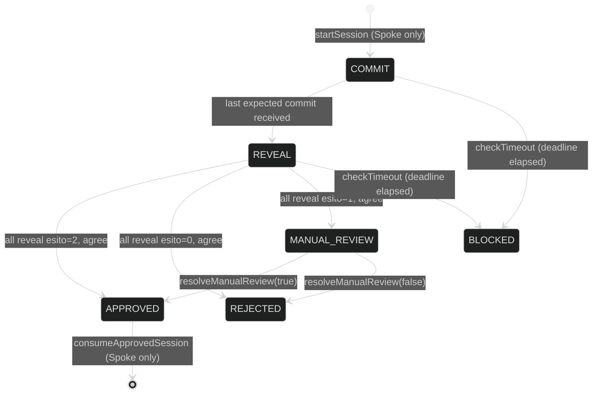

# Solvency MPC integration (thesis extension)

This document describes an addition to the Spoke that gates loan issuance on a
solvency verdict computed off-chain by a consortium of bank nodes via Secure
Multi-Party Computation (MP-SPDZ), published on-chain through a commit-reveal
protocol with **no relayer, oracle, or other intermediary**: every node sends
its own commit and reveal transactions directly to the contract. The Hub's
liquidity accounting, interest rates, collateral, LTV, and liquidation logic
are all unmodified.

This supersedes an earlier prototype design (documented in the sibling MPC
repository) built around a `CollateralRiskOracle` threshold-multisig contract
plus a `publisher` microservice that alone talked to the chain. That publisher
held only a gas-paying key and could never forge a quorum, but it was still a
single point of failure on *availability* — if it was down or censored,
nothing reached the chain even with a fully valid quorum of signatures ready.
The design here removes that role entirely: nodes publish for themselves.

## What was built

### Contracts

- **`src/spoke/interfaces/ISolvencyRegistry.sol`** / **`src/spoke/SolvencyRegistry.sol`**
  (new). The commit-reveal registry and consortium membership registry.
- **`src/spoke/Spoke.sol`** / **`src/spoke/interfaces/ISpoke.sol`** (modified).
  Added:
  - `requestBorrowSolvencyCheck(reserveId, amount, onBehalfOf)` — opens a
    SolvencyRegistry session.
  - `borrow(reserveId, amount, onBehalfOf, solvencySessionId)` — a new
    **overload** of `borrow()` that requires and consumes an APPROVED session
    before running the existing borrow logic.
  - `setSolvencyRegistry(address)` / `solvencyRegistry()` — restricted
    setter/getter for the registry address.
  - The original 3-arg `borrow()` is **unchanged in behaviour and signature**;
    both overloads now share one internal `_borrow()` implementation so the
    actual Hub-draw / LTV / risk-premium logic exists exactly once.
- **`src/spoke/SpokeStorage.sol`** (modified). Added one storage slot
  (`_solvencyRegistry`), consuming one unit from the existing upgradeable-proxy
  storage gap (`uint256[50] → uint256[49]`).
- **`src/deployments/utils/libraries/Roles.sol`** (modified, purely additive).
  Added a new role namespace `SOLVENCY_REGISTRY_DOMAIN_ADMIN_ROLE = 500` and
  its selector getter, and appended `ISpoke.setSolvencyRegistry.selector` to
  the existing `SPOKE_CONFIGURATOR_ROLE` (301) selector list.

### Tests

New directory `tests/contracts/spoke/solvency/`:

- `SolvencyTestBase.sol` — shared fixture (deploys a 3-participant
  SolvencyRegistry, wires it into `spoke1`, grants the governor role).
- `Spoke.Solvency.Commit.t.sol` (5 tests) — happy path, non-participant,
  duplicate commit, out-of-sequence commit, commit after timeout-block.
- `Spoke.Solvency.Reveal.t.sol` (5 tests) — happy path (APPROVED), commit
  mismatch, missing participant → timeout → BLOCKED, non-participant reveal,
  genuine disagreement between two participants.
- `Spoke.Solvency.BorrowIntegration.t.sol` (5 tests) — APPROVED → borrow
  succeeds and consumes the session (replay blocked); RIFIUTATO → no funds
  move; REVIEW_MANUALE → pending, then resolved both ways; a regression check
  that the untouched 3-arg `borrow()` still works.
- `Spoke.Solvency.Membership.t.sol` (6 tests) — change queued while a session
  is active and not applied early; registry blocks a new session both while
  `SESSION_ACTIVE` and while `MEMBERSHIP_APPLYING`; apply then start a new
  session; propose-while-idle applies immediately; cannot remove the last
  participant; access-control reverts for a non-governor caller.

**21/21 new tests pass.** A full `forge test` run against the whole existing
suite (2000+ tests, including the heavy liquidation/borrow fuzz suites at
1000 runs each) shows **zero regressions** — the only two things that needed
updating were a pre-existing unit test asserting the old (7-element)
`SPOKE_CONFIGURATOR_ROLE` selector count, and two call sites (`ISpoke.borrow.selector`,
`abi.encodeCall(ISpoke.borrow, ...)`) that needed disambiguating now that
`borrow` is overloaded — both mechanical, neither touching test intent.

### Repository cleanup

Removed (safe, unrelated to any code path): `audits/` (PDF-only, ~8 MB) and
`.github/` (CI workflows tied to the upstream `aave/aave-v4` repository's own
release process, not exercised by a local `forge build`/`forge test`).

**Not removed, flagged for your own review instead** (per your instruction to
signal doubtful cases rather than delete silently): `TokenizationSpoke.sol`,
`TreasurySpoke.sol`, `NativeTokenGateway.sol`, and the other
position-manager/gateway contracts. These are not touched by this change, but
they're live code exercised by the shared test fixtures (`Base.t.sol` deploys
the whole system), so removing them is a larger, separable decision with real
risk of breaking the build — left for you to decide, not silently kept or cut.

## Design

### Commit-reveal state machine

A session is created by `Spoke.requestBorrowSolvencyCheck`, which snapshots
the *current* consortium as the session's expected participants. Each
participant node then, **directly, in its own transaction**:

1. `submitCommit(sessionId, keccak256(sessionId, esito, policyVersion, timestamp, salt))`
2. once all expected commits are in, `submitReveal(sessionId, esito, policyVersion, timestamp, salt)`

Only `(esito, policyVersion, timestamp)` ever reaches the chain — never the
numeric risk score or the LTV/liquidation-threshold figures the MPC
computation also reveals to the participating nodes off-chain. This mirrors
the privacy stance already established in the superseded oracle design: a
risk figure bound permanently and publicly to a wallet address is a larger,
longer-lived data exposure than sharing it privately among consortium nodes.

### No signature field on commit or reveal

The superseded oracle design needed ECDSA signatures verified via `ecrecover`
because a single relayer submitted every platform's agreement in one bundled
transaction — the signature was the only way to attribute a statement to a
specific platform. Here, every node sends its **own** transaction directly, so
`msg.sender` already *is* the authenticated identity (an Ethereum transaction
is inherently signed by its sender's key). Adding a redundant in-payload
ECDSA signature would just re-verify, at extra gas cost, something the EVM
already verified to accept the transaction. This stops being true only if a
relayer or meta-transaction path is reintroduced later — deliberately not
done here, since that would recreate the availability single point of failure
this design exists to remove.

### Concurrency: one session at a time, registry-wide

Only one solvency session may be active across the whole registry, not one
per client. This is grounded in a documented, unresolved operational
limitation of the underlying MP-SPDZ node network this registry coordinates:
each node's own request queue is independent and single-worker, and has been
observed to desynchronize from its peers under concurrent load, producing
spurious failures unrelated to the cryptography itself. Reflecting that real
constraint in the contract — rather than allowing concurrent sessions the
off-chain layer cannot yet reliably support — was a deliberate choice. A
future revision that fixes the underlying queue-synchronization problem could
relax this to true per-client concurrency without changing the commit-reveal
mechanics themselves.

### `borrow()` overload vs. changing the existing signature

The gated path is a new 4-argument `borrow()` overload, not a change to the
existing 3-argument one. Changing the existing signature would have forced
either rewriting the whole pre-existing spoke test suite (borrow, liquidation,
multi-hub, risk-premium, …) or silently changing behaviour for callers
outside the MPC consortium flow. The trade-off: the plain 3-arg `borrow()`
remains reachable and **not** gated by any solvency check — making the gate
mandatory system-wide would require either that breaking signature change or
restricting, at the deployment/governance layer, which PositionManager
callers may reach the 3-arg path at all. Both are explicitly out of scope
here and are flagged rather than silently decided.

### Consortium scalability (adding/removing a bank)

A membership change (`proposeMembershipChange` / `applyQueuedMembershipChange`)
reuses the same registry-wide phase used for solvency sessions
(`IDLE` / `SESSION_ACTIVE` / `MEMBERSHIP_APPLYING`):

- Proposed while `IDLE` → the registry moves straight to
  `MEMBERSHIP_APPLYING`, an observable state, not just a same-transaction
  detail.
- Proposed while `SESSION_ACTIVE` → queued; applied automatically (registry
  moves to `MEMBERSHIP_APPLYING`) only once the active session ends
  (approved, rejected, or blocked by timeout) — a computation in progress can
  never be interrupted or have its participant set changed mid-flight.
- While `MEMBERSHIP_APPLYING`, `startSession` is refused (`RegistryBusy`) —
  no new computation can begin with an ambiguous "who's actually in the
  consortium right now" state.

**Explicitly out of scope, flagged rather than assumed**: applying the
on-chain membership change does **not** reconfigure the off-chain MP-SPDZ
network. Before a new session can safely run with the new participant count,
operators must, out-of-band: regenerate SSL certificates for the new party
count (`Scripts/setup-ssl.sh` in the sibling MPC repository), exchange the new
certificate manually (never over the network `-e` protects), and recompile
`crypto_collateral_risk.mpc` for the new N. The contract has no way to verify
or enforce that this happened before the next session starts.

### Manual review

`REVIEW_MANUALE` sessions have **no timeout path** — they stay pending until
an authorized operator calls `resolveManualReview`. This mirrors a principle
already established in the superseded design's own documentation: automating
manual review would reintroduce exactly the single point of trust/failure the
whole architecture exists to avoid. If this is ever automated, the
architecturally consistent path is a second MPC round with a more permissive
policy threshold agreed by the consortium — not an external, centralized
service.

## Open governance questions (deliberately not resolved here)

Both flagged prominently in the contracts' own NatSpec, repeated here:

1. **Who holds `SOLVENCY_REGISTRY_DOMAIN_ADMIN_ROLE`** — the role gating
   `proposeMembershipChange`, `applyQueuedMembershipChange`, and
   `resolveManualReview`? A dedicated consortium multisig, a subset of Aave's
   own governance, a separate DAO — this is a governance decision outside
   this codebase's scope. The implementation only enforces that *some*
   authorized role is required and that membership changes never overlap an
   active session.
2. Related: this same role currently covers **both** consortium-membership
   governance and manual-review resolution, as one role rather than two
   granular ones. Kept as a simplification for this prototype since both
   concern "who speaks for the consortium," not a requirement.

## Parameters

- `SESSION_TIMEOUT_SECONDS` (constructor argument, no protocol-level default):
  must exceed the off-chain MPC layer's own internal timeout with real
  margin. The existing node deployment budgets 600s per `mascot-party.x` run;
  1200s is a reasonable deployment default, but this is operational, not a
  protocol constant.
- `APPROVAL_VALIDITY_SECONDS` (constructor argument): how long an APPROVED,
  unconsumed session remains usable before `consumeApprovedSession` refuses
  it as expired.

## Not done (explicitly, not silently)

- Multi-Spoke support: this integration targets a single Spoke instance per
  SolvencyRegistry (`SPOKE` is immutable).
- Any on-chain mechanism to verify the off-chain MP-SPDZ network was actually
  reconfigured for a new consortium size before the next session starts.
- A timelock on governance actions (membership changes, manual review
  resolution) — these execute immediately once the authorized role calls
  them.
- Splitting the single `SOLVENCY_REGISTRY_DOMAIN_ADMIN_ROLE` into more
  granular roles (see open questions above).
